# Analysis Board Architecture: PGN/FEN Import, Setup Position & Collaborative Rooms

## 1. Overview & 27-Extension Dependency Injection Pipeline
The core analysis application (`analysis.js`, `shared.a3c617d1.BRTUNtNrvF.chunk.js`, `tab-analysis.3e85b73f.XUtQDAGH37.chunk.js`) is constructed using a decoupled micro-extension architecture. When the analysis board initializes, it binds 27 specialized extensions into the shared context:

```mermaid
flowchart TD
    App["Analysis App Container (Eq)"] --> Exts["27 Core Extensions (wq)"]
    Exts --> E1["chessboardExtension"]
    Exts --> E2["evaluationExtension (Stockfish Multi-PV & Eval Bar)"]
    Exts --> E3["explorerExtension (Master Games & W/D/L)"]
    Exts --> E4["gameArchiveExtension (User Archive & PGNs)"]
    Exts --> E5["gameCollectionsExtension (Personal & Community Repertoires)"]
    Exts --> E6["threatsExtension (Null-Move Engine Pass)"]
    Exts --> E7["coachExtension (Komodo TEP & Visemes)"]
    Exts --> E8["sharedBoardExtension (Live Analysis Rooms)"]
    Exts --> E9["arrowsAndSquaresExtension (SVG Tactical Annotations)"]
    Exts --> E10["explainLineExtension (Komodo Move Clarification)"]
    Exts --> E11["retriesExtension (Interactive Move Retry Engine)"]
    Exts --> E12["skillsExtension (Gamified Skill Mastery XP)"]
    Exts --> E13["pubSubExtension (WebSockets Telemetry & Presence)"]
```



---

## 2. Smart PGN & FEN Import (`analysis-smart-input`)

The modern analysis import interface (`analysis-smart-input`, `load-from-pgn`) accepts multiple heterogeneous inputs through a unified input field:
- **Raw PGN Strings:** Single games or multi-game PGN databases.
- **FEN Strings:** Full or truncated FEN strings (auto-completed with default castling and turn flags).
- **Drag-and-Drop Files:** `.pgn` and `.txt` files dragged directly over the input container triggers `dragging` CSS class overlays and parses file streams via `FileReader` / `File.text()`.
- **Study / Lichess URLs:** Automatically detects third-party study links via regex:
  ```javascript
  df = /^(https?:)?\/\/|^www\./i;
  ff = /^[a-z0-9-]+(\.[a-z0-9-]+)*\.[a-z]{2,}(\/|\?|#|$)/i;
  ```
  Routes to the backend endpoint `/callback/classroom/import-study` to fetch and normalize the PGN chapters.

---

## 3. Position Setup & Custom Board Editor (`setup-position`)

The `setup-position` component allows users to construct custom positions:
1. **Piece Palettes (`wc-hand-pieces`):** Provides White and Black piece reserves for drag-and-drop piece placement.
2. **Turn Toggle:** Toggles White / Black to move.
3. **Castling Rights State Mask:** Checkboxes for White (`O-O`, `O-O-O`) and Black (`O-O`, `O-O-O`) dynamically manipulate the 3rd field of the FEN (`KQkq`).
4. **Safety Reset Dialogs:**
   - **Clear Board:** Clears all pieces (`8/8/8/8/8/8/8/8 w KQkq - 0 1`) with an interactive modal confirmation.
   - **Reset Board:** Restores the standard initial chess array (`rnbqkbnr/pppppppp/8/8/8/8/PPPPPPPP/RNBQKBNR w KQkq - 0 1`).
5. **Real-Time FEN Completion & Validation:**
   ```javascript
   let n = Cn.completeFen(e.fen);
   if (!Ug(n)) {
     Ve(E("Invalid FEN"));
     return;
   }
   ```

---

## 4. Collaborative Analysis Rooms & Broadcast Boards

The `tab-analysis` component manages multi-user live collaborative boards via the `SharedBoardEntryState` state machine (`shared-board-entry-state.vue`):

| State Enum (`b`) | UI Header | Subheader / Action | Available Actions |
|---|---|---|---|
| `Requesting` | *Request Sent* | "Please wait a few moments for the host to accept your request." | `Cancel Request` |
| `Declined` | *Request Declined* | "Your request has been declined by the host." | `Go Back` |
| `Invited` | *Invitation pending* | "Accept the Analysis Room invitation to join this session." | `Accept Invitation` |
| `Loading` | *Opening Analysis Room* | "Loading the Analysis Room session..." | Spinner |
| `Connected` | *Analysis Room Active* | Real-time synchronized board moves & arrows via WebSocket PubSub. | Full analysis controls |
| `Ended` | *Analysis Room ended* | "The host ended this Analysis Room session." | Return to solo board |
| `NotFound` | *Analysis Room not found*| "This link is no longer valid, or the session has ended." | Dismiss |
| `Unavailable`| *Analysis Room unavailable*| "This Analysis Room could not be opened." | Dismiss |

---

## 5. Game Collections & Library System (`load-from-library`)

The personal library system enables users to organize saved games and analysis studies:
- **Collection Tabs:**
  - `MyCollections` (`your-collections`): Personal collections owned by the user.
  - `SharedCollections` (`shared-collections`): Collections where the user was invited as an editor/viewer.
  - `MyBookmarks` (`bookmarks`): Bookmarked public community collections.
  - `CommunityCollections` (`community-collections`): Curated public collections created by master players.
- **Sorting Modes:** Alphabetical (`sort=8`), Most Recent (`sort=1`), Most Popular (`sort=9`).
- **Batch Add to Analysis:** Allows selecting multiple games from any collection to load sequentially into the analysis sidebar carousel.
