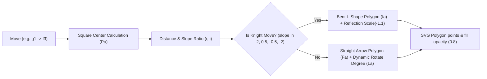

# Multi-PV Engine Lines, Null-Move Threats & Pure CSS Mini-Board Preview

## 1. Overview & Architectural Role
The multi-PV analysis engine (`analysis` package, `shared.fe7dcb3d.DiJUwdfW6u.chunk.js`) powers real-time local Stockfish line evaluation, cloud deep search ("Max Analysis"), suggestion arrows, and threat exploration.

Key capabilities extracted from the client source:
1. **Configurable Multi-PV Lines (1 to 5 lines):** Displays depth, centipawn score or forced mate (`+2.45`, `M4`), and interactive SAN move tokens.
2. **Hover Mini-Board Preview:** Hovering over any candidate move token in an engine line renders an instant floating mini-chessboard of the resulting position without changing the main board.
3. **Pure CSS Sprite Board vs Lazy-Loaded Image Board:** Uses a lightweight CSS-based multi-background sprite renderer for instant 0ms latency rendering of preview boards.
4. **Engine Download Progress Bar:** Live percentage and speed ETA display during WASM / NNUE asset streaming.
5. **Null-Move Threat Detection:** Emits Stockfish `position fen ...` followed by `fetch threats` to evaluate immediate tactical threats if the opponent were given a free consecutive move.
6. **Procedural SVG Arrow & Badge Mathematics:** High-precision SVG polygon generation for straight moves, diagonal moves, and L-shaped knight moves.

---

## 2. Hover Mini-Board Preview (`game-preview-css`)

### High-Performance Pure CSS Multi-Background Rendering
Instead of instantiating 64 DOM image nodes or a canvas for board previews, Chess.com compiles the entire position into a single CSS background property on a `<div>`:

```javascript
function Ja({ piece: e, theme: t, isPseudo3dPieceSet: n }) {
  let r = qi({ piece: e, theme: t }),
      i = n ? "bottom" : `${(100 / 7) * e.row}%`;
  return `${r} ${(100 / 7) * e.column}% ${i} / 12.5% no-repeat`;
}

function Xa({ theme: e, pieces: t }) {
  let n = [];
  t.forEach(piece => {
    if (piece.row <= 7) n.push(Ja({ piece, theme: e, isPseudo3dPieceSet: false }));
  });
  n.push(Gi(e)); // Adds board background texture at base
  return n.join(", ");
}
```
- Each square represents `12.5%` (`100% / 8`).
- All 32 pieces and the square colors are joined into one CSS `background: url(...), url(...), ...` string with hardware-accelerated `transform: translateZ(0)`.
- If `web_game_preview_lazy_load` feature flag is active, it falls back to `game-preview-lazy` with native browser ``.

---

## 3. Procedural SVG Arrow Mathematics

The client calculates dynamic SVG arrow coordinates for any move (`from -> to`):



### Coordinate & Vector Formulas
- **Grid Offset:** Square width `q = 12.5%`, board total `J = 100%`.
- **Center of square:** `x = col * 12.5 + 6.25`, `y = (8 - rank) * 12.5 + 6.25`.
- **Length:** `r = sqrt((dx)^2 + (dy)^2)`.
- **Slope:** `i = (dy / dx).toFixed(1)`.
- **L-Shaped Knight Path:** When `slope` matches `[2, 0.5, -0.5, -2]` and `distance == sqrt((25)^2 + 12.5^2)`:
  ```javascript
  function Ia() {
    let e = q * 2, t = 26.375, n = 12.5, r = n - Ba;
    return [[-1.375, Y], [-1.375, t], [r, t], [r, 28.25], [n, e], [r, e - Va], [r, e - X], [X, e - X], [X, Y]];
  }
  ```
- **Standard Colors:**
  - `blue`: `rgba(72, 193, 249, 0.8)`
  - `green`: `rgba(159, 207, 63, 0.8)`
  - `orange`: `rgba(255, 170, 0, 0.8)`
  - `red`: `rgba(248, 85, 63, 0.8)`

---

## 4. Multi-PV Line Renderer & Interactive Node Navigation

### `EngineLine` Specs
- **Thinking Shimmer:** While the engine evaluates a new position (`isEngineEvaluatingNewPosition`), a skeleton loader (`thinking-score`, `thinking-line`) animates across the row.
- **Node Clicks:** Clicking any move in an engine line automatically previews or loads the variation into the analysis tree:
  ```javascript
  function se(e) {
    if (i.nodesClickable) {
      let t = i.line.pvSan.slice(0, e + 1);
      if (i.sendScoreOnLineClick) {
        emit("node-click", { sanMoves: t, score: evalScore });
      } else {
        emit("node-click", t);
      }
    }
  }
  ```
- **Hover Preview Positioning:** Calculates exact viewport bounding rect of the hovered move token and floats the mini-board directly above/below without overflowing viewport boundaries.

---

## 5. Null-Move Threat Detection (`threatsExtension`)

The threats engine (`threatsExtension` in `analysis.js`) diagnoses immediate opponent threats by performing a null-move pass:
1. In the current position, the engine issues:
   ```text
   position fen <FEN>
   fetch threats
   ```
2. The engine evaluates candidate opponent responses:
   - Identifies candidate checks, captures, and unstoppable forks.
   - Computes `Static Exchange Evaluation` (`seeValue`), `score`, and `mate` distance.
3. Renders red tactical threat arrows with unique tags `[AS]` (`Tags.Threats`), updating whenever the user toggles the threats button or navigates between plies.
