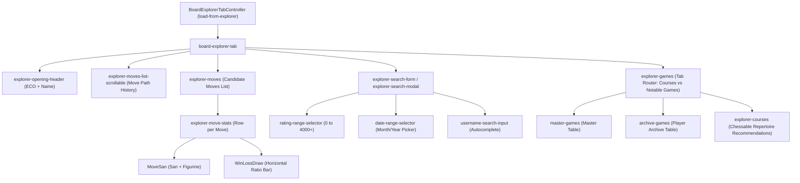

# Opening Explorer, Master Games Database & Win/Loss/Draw Stats Engine

## 1. Overview & Architectural Role
The **Opening Explorer** (`board-explorer-tab`, `explorer-moves`, `master-games`, `explorer-search-form`) in Chess.com's web client (`analysis` package, `shared.533ee0c1.Bb4IYF0T43.chunk.js`) provides interactive tree traversal across millions of games played on Chess.com and historical Master tournament games dating back to 1475.

It visualizes candidate moves at each ply with:
1. **Move Frequency & Total Volume:** Formatted game counts and percentage frequency among candidate branches.
2. **Tri-Color Win/Loss/Draw Bars:** Responsive percentage bars visualizing White wins, Draws, and Black wins.
3. **Engine Centipawn Evaluations:** Pre-computed or real-time evaluation overlay per candidate move.
4. **Master Games Game Preview:** Expandable move list within game items allowing inline branch preview directly on the mini or main board.
5. **Interactive Filtering System:** Multi-dimensional filtering by player name, ELO rating range (0 to 4000+), date ranges (from 2007 to present), time controls (`daily`, `rapid`, `blitz`, `bullet`), and ECO opening families.
6. **Chessable Course Recommendations:** Integration linking the current board position (`FEN`) to curated opening repertoires on Chessable.

---

## 2. Core Components & Hierarchy



---

## 3. Candidate Move Stats & Win/Loss/Draw Math

### Win/Loss/Draw Distribution
The component [`WinLossDraw`](file:///Users/jonathanarndt/dev/chess_teacher/captured_network/dump_2026-10-21T05-47-01-851Z/network/www.chess.com/r2/client-packages/analysis/2026.10.3-hotfix.20ef972/shared.533ee0c1.Bb4IYF0T43.chunk.js) renders three proportional flex segments:
- **White Won:** `.percentage-white` (Default color: `#ffffff` / light mode `#f1f1f1`)
- **Draw:** `.percentage-draw` (Default color: `#999999` / medium gray)
- **Black Won:** `.percentage-black` (Default color: `#312e2b` / dark charcoal)

### Percentage Computation & Display Rounding
```javascript
function ec(e, t) {
    if (e <= 0 || t <= 0) return "0%";
    let n = (e / t) * 100;
    return n > 0 && n < 1 ? "<1%" : `${Math.round(n)}%`;
}
```
When total games for a candidate move are rendered:
- If a win rate is strictly between `0%` and `1%`, it formats as `<1%` rather than `0%` to prevent misleading zero-win indications for rare master wins.
- Total games are formatted via `br(n.move.stats.totalGames)` (e.g. `1.2M`, `450K`, `3,421`).

### Overall Position Summary Row (`total-row`)
When more than 1 candidate move is available, `explorer-moves` computes an aggregate weighted total:
- **Weighted White Win Rate:** `Sum(games_i * whiteWon_i) / totalGames`
- **Weighted Draw Rate:** `Sum(games_i * draw_i) / totalGames`
- **Weighted Black Win Rate:** `Sum(games_i * blackWon_i) / totalGames`
- Displays a `100%` frequency label and the full database game count for the FEN.

---

## 4. Multi-Source Filtering & Database Selection

The explorer supports 4 distinct database sources via enum `w`:
1. `w.Master` (`"master"`): Curated FIDE & historic master games database (1475–present). Unlimited move depth.
2. `w.Own` (`"own"`): Currently authenticated user's own game history.
3. `w.Other` (`"other"`): Public games from any specified Chess.com player username.
4. `w.AllGames` (`"all-games"`): Chess.com site-wide rated games database (>1 Billion games).
   - **Depth Constraint:** Max Explorer depth is capped at 40 ply (20 full moves) on `AllGames` to protect database cluster load:
   ```javascript
   let l = L(() => i.explorerSearch.source === w.AllGames && (i.selectedMovePly ?? 0) >= 40);
   // Displays: "Move Limit Reached. Master Games have no move limit."
   ```

### Rating Range Selector
Supports granular bucket filtering: `[0, 200, 400, 600, 800, 1000, 1200, 1400, 1600, 1800, 2000, 2200, 2400, 2600, 2800, 3000, 4000]`.
- Enforces `lowerRating < upperRating`.
- Automatically bumps `upperRating` to the next interval if `lowerRating` is set higher.

---

## 5. Horizontal Scrollable Move Ribbon (`explorer-moves-list-scrollable`)
To allow swift navigation through the active line without taking vertical screen space, the explorer renders a smooth horizontal scroll strip with:
- **Dual Gradient Fade Masks:** Dynamic classes `fade-left`, `fade-right`, and `fade-both` applied automatically when scrollable overflow exists.
- **Scroll Chevrons:** Left and right chevron buttons that smooth-scroll by `65%` of the container width (`clientWidth * 0.65`).
- **Active Node Auto-Centering:** Uses `ResizeObserver` and `scrollTo`:
  ```javascript
  let n = t.offsetLeft + t.offsetWidth / 2 - e.clientWidth / 2;
  e.scrollTo({ left: Math.max(0, Math.min(n, e.scrollWidth - e.clientWidth)), behavior: "smooth" });
  ```

---

## 6. Chessable Repertoire Integration
In positions matching curated opening courses, `explorer-courses` queries:
`https://api-v1-course-recommend.chessable.com/api/v1/course/recommend?fen=...&gameType=...&rating=...`
- Renders course thumbnail (64x64px), course title, author grandmaster, rating stars (e.g. `4.9 ★ (182)`), and deep links into the variation preview.
