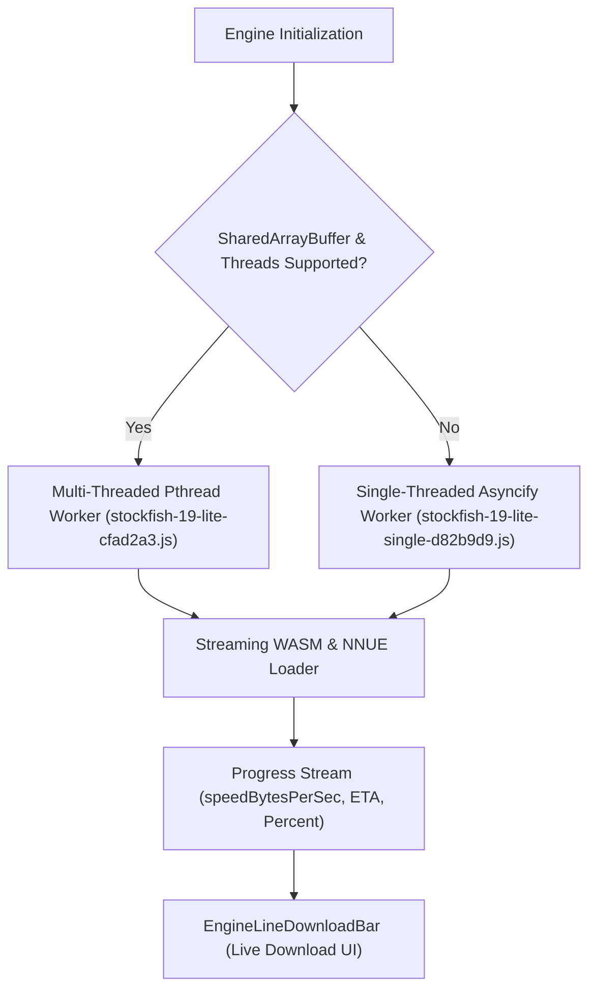

# Stockfish 19 WASM Engine Architecture, 8px Snapping Layout & Bot Crowns

## 1. Stockfish 19 WASM Engine Architecture
Chess.com's browser engine layer runs Stockfish 19 compiled to WebAssembly with high-efficiency NNUE evaluation networks (`nn-61e7af4bb97d` by Chris Bao).

The engine bundle provides two distinct execution modes:
1. **Multi-Threaded Pthreads WASM (`stockfish-19-lite-cfad2a3.js`):**
   - Utilizes `SharedArrayBuffer` and Web Workers (`stockfish.worker.js`).
   - Automatically detects CPU concurrency via `navigator.hardwareConcurrency` (or Node.js `os.cpus().length`).
   - Employs Emscripten Pthreads thread pool (`E.ea`, `E.ja`, `E.da`) with proxying queues and thread sleep/wake synchronization.
2. **Single-Threaded WASM Fallback (`stockfish-19-lite-single-d82b9d9.js`):**
   - Automatically activated when `SharedArrayBuffer` or cross-origin isolation headers (`COOP`/`COEP`) are not supported in the host environment.
   - Employs Asyncify (`_asyncify_start_unwind`, `_asyncify_stop_rewind`) to handle non-blocking engine search interrupts and UCI loop execution without freezing the main UI thread.



---

## 2. Streaming WASM Download & ETA Telemetry
During initial engine download, the client reads the binary stream in chunks using `ReadableStream` and `getReader()` to emit real-time speed and ETA statistics to the UI:

```javascript
function p(e, n, t) {
  var speed = e / ((Date.now() - t || 1) / 1000),
      eta = speed > 0 && e < n ? (n - e) / speed : 0;
  return {
    percent: e / n,
    loaded: e,
    total: n,
    speedBytesPerSec: speed,
    speedText: speed < 1024 ? Math.round(speed) + " B/s" :
               speed < 1048576 ? (speed / 1024).toFixed(1) + " KB/s" :
               (speed / 1048576).toFixed(1) + " MB/s",
    eta: eta,
    etaText: !eta || eta < 0 ? "" :
             eta < 60 ? Math.ceil(eta) + " sec" :
             Math.round(eta / 60) + " min"
  };
}
```
The downloaded chunks are fed into `WebAssembly.instantiateStreaming` (or fallback `ArrayBuffer` compilation), emitting `info WillOutputEngineDownloadProgress` to the main application.

---

## 3. Responsive Board 8px Snapping Layout (`chessboard-layout.HnVOpg4u5j.js`)

To prevent subpixel rendering artifacts and piece blurriness, the chessboard container strictly snaps its dimensions to multiples of **8 pixels** (1 integer pixel per board square):

### Modern CSS vs JavaScript Fallback
- **Modern Browsers (Safari 17+, Chrome 111+, Firefox):**
  Uses modern CSS `round()` function:
  ```css
  --modifiedBoardWidth: round(down, var(--rawWidth), 8px);
  ```
- **Legacy Fallback:**
  When `CSS.supports("width: round(down, 257px, 8px)")` returns `false`, the layout engine computes the snapped width dynamically in JavaScript:
  ```javascript
  document.body.style.setProperty("--modifiedBoardWidth", `${e - (e % 8)}px`);
  ```

### Drag-to-Resize Handle & RTL Support
- **RTL Detection:** Detects `document.documentElement.getAttribute("dir") === "rtl"`. When in RTL mode, dragging direction is mirrored by multiplying delta by `-1`.
- **LocalStorage Persistence:** Caches the user's customized board width under:
  `Resource.<USER_UUID>.boardLayoutSize`
  Prevents layout shift when refreshing or navigating across tabs.

---

## 4. Bot Crown Progression System (`crowns-in-player-row`)

In the Play Computer mode, bot crowns measure a user's mastery over individual AI personalities:

### Crown Rules (`play-computer-bot-crowns-intro-modal`)
| Crowns Awarded | Criteria |
|---|---|
| 👑 👑 👑 (3 Crowns) | Win the game with **zero help** (0 Hints, 0 Undos). |
| 👑 👑 (2 Crowns) | Win the game using **1 to 3 Hints or Undos**. |
| 👑 (1 Crown) | Win the game using **more than 3 Hints/Undos**. |
| 0 Crowns | Loss, Draw, or Abandonment. |

### Visual Components
- **`crowns-in-player-row`:** Embedded in the opponent profile header with gold filled crown icons (`crown-gold`) and inactive silhouette icons (`crown-inactive`).
- **`crowns-animated`:** Plays gold scale animations (`scale`, `animated`, `xLarge`) when the user clinches an upgraded crown tier upon bot defeat.
